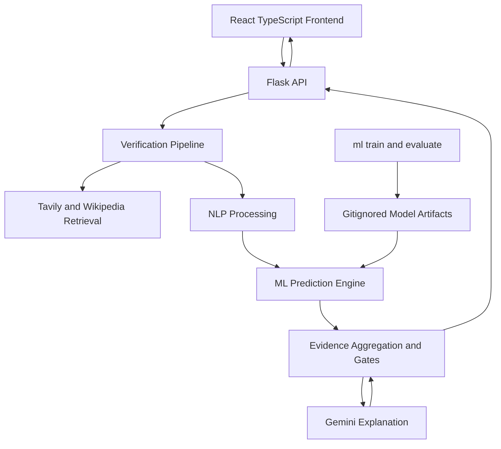
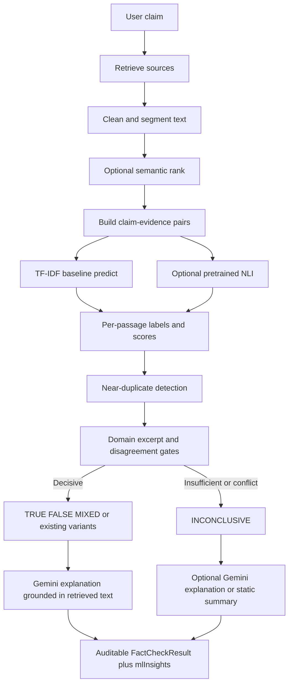
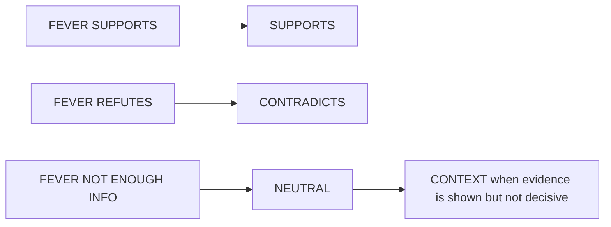
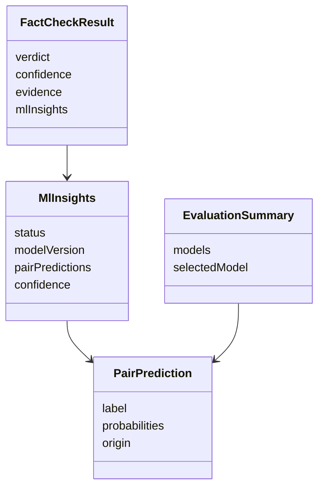
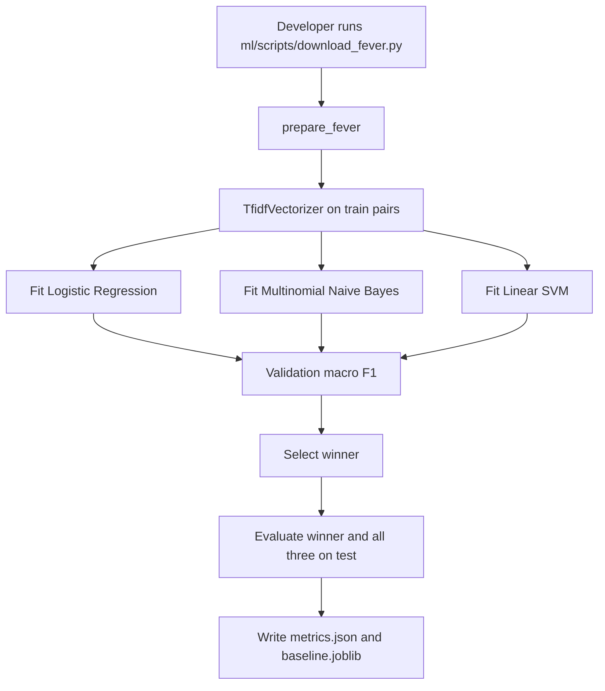
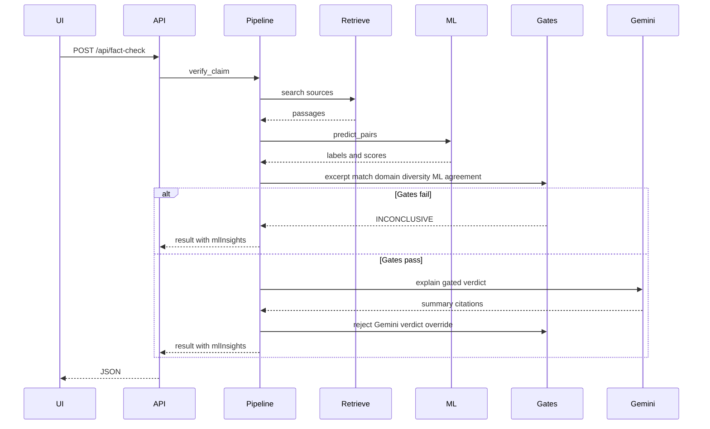
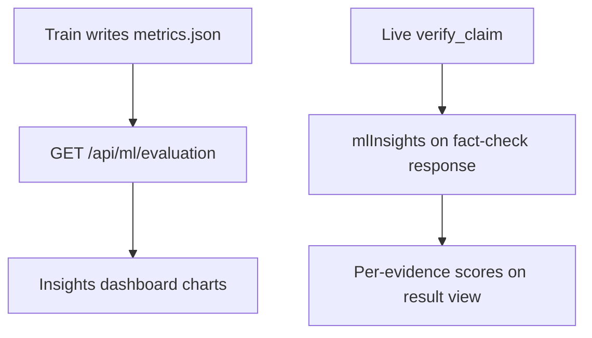

# Design Document

## Overview

This design upgrades the existing FactCheckAI repository with an Evidence Intelligence Engine. The React frontend and Flask backend stay in place. A new `ml/` package owns dataset preparation, training, evaluation, and model export. Flask loads exported artifacts at inference time. Gemini remains an explanation layer and cannot replace gated ML or evidence decisions.

Phase 1 is the first implementation slice: FEVER claim-evidence TF-IDF baselines (Logistic Regression, Multinomial Naive Bayes, Linear SVM), measured evaluation, and Flask integration of the selected model. Later phases add pretrained NLI, semantic ranking, confidence calibration, ML Insights UI, and ML engineering.

### Design goals

- Keep the live evidence-first product working while ML is added on feature branches.
- Train classical models in this repository and report only measured metrics.
- Label pretrained transformers as pretrained.
- Fail closed to `INCONCLUSIVE` when evidence or models are insufficient.

### Key decisions

| Decision | Choice | Rationale |
| --- | --- | --- |
| Primary baseline task | FEVER claim-evidence pair classification | Matches evidence verification, not claim-only gossip classification |
| Pair encoding | `claim [SEP] evidence` into a shared TF-IDF space | Simple, interview-explainable, works with sklearn Pipelines |
| Production baseline selection | Highest validation macro F1; tie-break Linear SVM, then Logistic Regression, then Naive Bayes | Macro F1 handles FEVER class imbalance better than accuracy |
| Model persistence | `joblib` Pipeline in `ml/artifacts/`, gitignored | Single object contains vectorizer and classifier |
| Gemini role | Explanation and citation drafting only | Satisfies non-override requirement |
| Frontend verdict alias | Keep mapping `INCONCLUSIVE` to `UNVERIFIED` on the HTTP boundary | Existing UI types already use `UNVERIFIED` |
| Heavy models | Optional extra; degrade if missing | Windows CPU demo must still run Phase 1 |

## Architecture Design

### System Architecture Diagram



### Data Flow Diagram



## Component Design

### Component: ML Dataset Prep

- Responsibilities: download FEVER, build pair examples, preprocess text, write processed splits under `ml/data/processed/`.
- Interfaces: `prepare_fever(output_dir, subset_size=None) -> SplitPaths`
- Dependencies: FEVER JSONL source, documented download script, no API keys.

### Component: Classical Trainers

- Responsibilities: fit three sklearn Pipelines, tune on validation, evaluate on test, write `metrics.json` and selected `baseline.joblib`.
- Interfaces: `train_baselines(split_paths) -> EvaluationReport`
- Dependencies: scikit-learn, joblib.

### Component: ML Inference Service

- Responsibilities: load selected Pipeline once, predict labels and probabilities for claim-evidence pairs, expose model version.
- Interfaces: `predict_pairs(claim: str, passages: list[str]) -> list[PairPrediction]`
- Dependencies: exported artifact. Missing artifact returns `mlStatus: unavailable` without crashing Flask.

### Component: NLI Adapter Phase 2

- Responsibilities: optional pretrained MNLI model mapping entailment/contradiction/neutral to product labels.
- Interfaces: `predict_nli(claim: str, passage: str) -> NliPrediction`
- Dependencies: transformers only when installed and enabled.

### Component: Semantic Ranker Phase 2-3

- Responsibilities: embed claim and passages, cosine rank, near-duplicate flags.
- Interfaces: `rank_passages(claim: str, passages: list[Passage]) -> list[RankedPassage]`
- Dependencies: sentence-transformers extra; fallback lexical overlap if unavailable.

### Component: Confidence Calibrator Phase 3

- Responsibilities: feature vector from domain count, relevance, class probabilities, agreement, contradiction ratio, coverage; output calibrated confidence; never claim heuristic is a probability.
- Interfaces: `estimate_confidence(features: ConfidenceFeatures) -> CalibratedConfidence`
- Dependencies: held-out validation predictions from FEVER and, later, live-labeled samples if collected.

### Component: Verification Pipeline

- Responsibilities: orchestrate retrieval, ML, existing excerpt validation, domain gates, Gemini explanation, response assembly.
- Interfaces: existing `verify_claim(claim: str) -> dict` extended with `mlInsights`.
- Dependencies: `verification_gates.gate`, ML inference, Gemini.

### Component: ML Insights API and UI

- Responsibilities: attach per-check ML traces to the fact-check response; serve static evaluation metrics from `metrics.json` via `GET /api/ml/evaluation`.
- Interfaces: `FactCheckResult.mlInsights`, `EvaluationSummary`.
- Dependencies: frontend `FactCheckResult` types and a new Insights panel.

## Data Model

```typescript
type MlLabel = 'SUPPORTS' | 'CONTRADICTS' | 'NEUTRAL';
type FeverLabel = 'SUPPORTS' | 'REFUTES' | 'NOT ENOUGH INFO';
type ModelOrigin = 'trained-in-repo' | 'pretrained';
type ConfidenceKind = 'heuristic' | 'calibrated';
type MlRuntimeStatus = 'ok' | 'unavailable' | 'degraded';

interface PairPrediction {
  evidenceId: string;
  label: MlLabel;
  probabilities: Record<MlLabel, number>;
  modelId: string;
  origin: ModelOrigin;
  latencyMs: number;
}

interface RankedPassage {
  evidenceId: string;
  similarity: number;
  duplicateOf?: string;
}

interface ConfidenceBreakdown {
  kind: ConfidenceKind;
  value: number;
  independentDomains: number;
  evidenceCoverage: number;
  agreementRate: number;
  contradictionRatio: number;
  meanRelevance: number;
  meanSupportProb?: number;
}

interface MlInsights {
  status: MlRuntimeStatus;
  modelVersion: string;
  origin: ModelOrigin;
  pairPredictions: PairPrediction[];
  rankings?: RankedPassage[];
  selectedBaseline?: string;
  confidence: ConfidenceBreakdown;
  notes: string[];
}

interface EvaluationSummary {
  generatedAt: string;
  dataset: 'FEVER' | 'LIAR' | 'SciFact';
  split: 'test';
  models: Array<{
    name: string;
    origin: ModelOrigin;
    accuracy: number;
    macroF1: number;
    precisionPerClass: Record<string, number>;
    recallPerClass: Record<string, number>;
    confusionMatrix: number[][];
    labels: string[];
    inferenceLatencyMs: number;
  }>;
  selectedModel: string;
  selectionRule: string;
}
```

### Label mapping



`NEUTRAL` is the ML class. The existing evidence card relationship `CONTEXT` remains the UI tag for non-decisive passages so current cards do not break.

### Data Model Diagram



## Business Process

### Process 1: Train FEVER baselines



Default Phase 1 training uses a documented FEVER subset sized for CPU, plus a full-split command for the reported table. Both commands write the same metric schema. README tables are filled only from `metrics.json`.

### Process 2: Live verification with ML gates



Aggregation rule for Phase 3, already reserved in Phase 1:

- Count independent registered domains among decisive `SUPPORTS` / `CONTRADICTS` predictions after excerpt validation.
- Near-duplicates share one domain vote.
- If both support and contradict votes exist from distinct domains, verdict is `MIXED` when each side has at least two independent domains; otherwise `INCONCLUSIVE`.
- Gemini proposed verdict is ignored when it differs from the gated verdict.

### Process 3: ML Insights



## Error Handling Strategy

| Condition | Behavior |
| --- | --- |
| FEVER files missing during train | Exit non-zero with download instructions |
| `baseline.joblib` missing in Flask | `mlInsights.status = unavailable`; existing retrieval and gates still run; no fabricated ML scores |
| Transformer extra missing | `degraded`: classical baseline only; NLI fields omitted |
| Tavily failure | Keep Wikipedia fallback; if fewer than two domains, `INCONCLUSIVE` |
| Gemini unavailable | If gates already produced a verdict, return gated result with a static summary and `notes` that explanation is unavailable; if gates cannot run, current 503 path may remain for checks that still require Gemini until Phase 3 static summaries exist |
| Model disagreement | `INCONCLUSIVE` |
| Excerpt not in source text | Drop excerpt; existing dropped-ratio gate still applies |
| Dataset optional LIAR/SciFact missing | Skip those experiments with an explicit notice |

## Testing Strategy

- Unit tests for label mapping, pair encoding, missing-artifact inference, and Gemini non-override.
- Unit tests for existing gates remain; extend them with ML labels as another decisive-signal input.
- Training smoke test on a tiny fixture JSONL in `ml/tests/fixtures/` so CI does not download FEVER.
- Integration test: Flask `/api/fact-check` includes `mlInsights` when artifact is present.
- Evaluation contract test: `metrics.json` schema contains accuracy, macro F1, per-class precision/recall, confusion matrix, latency.

## Repository layout

```
ml/
  data/                 # gitignored raw/processed except README
  notebooks/            # exploration only; scripts are source of truth
  preprocessing/
  models/               # train.py predict.py evaluate.py
  embeddings/           # Phase 2
  nli/                  # Phase 2
  experiments/          # metrics outputs gitignored except schema examples
  scripts/
  tests/
backend/app/services/ml_inference.py
docs/model_evaluation.md
```

## Phase mapping

| Phase | Ships |
| --- | --- |
| 1 | `ml/` module, FEVER prep, three TF-IDF models, `metrics.json`, Flask `predict_pairs`, `mlInsights` fields, Gemini still explains |
| 2 | embeddings, ranking, pretrained NLI adapter, comparison row in `metrics.json` |
| 3 | Tavily ranking, contradiction aggregation, calibrated confidence |
| 4 | ML Insights UI and evaluation charts |
| 5 | versioning, experiment tracking, API docs, extra tests, demo notes |

## Requirement traceability

| Requirement | Design coverage |
| --- | --- |
| 1 ML module on feature branches | Repository layout, gitignore artifacts |
| 2 FEVER prep | Dataset Prep, Process 1 |
| 3 three algorithms and measured metrics | Classical Trainers, EvaluationSummary |
| 4 Flask serving | ML Inference Service, Process 2 |
| 5 NLI labels and pretrained honesty | NLI Adapter, ModelOrigin |
| 6 semantic ranking and duplicates | Semantic Ranker |
| 7 calibrated confidence | Confidence Calibrator, ConfidenceKind |
| 8 Gemini non-override | Process 2, Error Handling |
| 9 ML Insights | Insights API and UI |
| 10 LIAR and SciFact | optional experiment paths |
| 11 conservative verdicts | Gates and aggregation rule |
| 12 tests and versioning | Testing Strategy, modelVersion |
| 13 CPU-friendly defaults | subset training, optional transformers |
