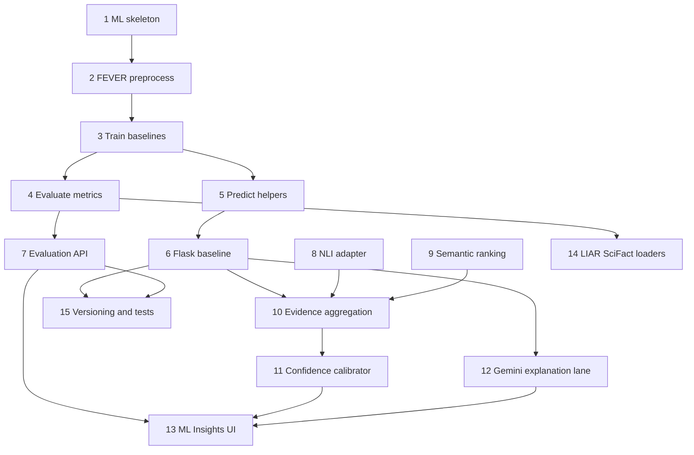

# Implementation Plan

- [ ] 1. Create the ML package skeleton, gitignore rules, and CI-safe fixtures
  - Add `ml/` package layout: `preprocessing/`, `models/`, `scripts/`, `tests/fixtures/`, `data/README` placeholders
  - Gitignore raw FEVER, processed dumps, `*.joblib`, experiment outputs, and embedding caches
  - Add `ml/requirements.txt` with scikit-learn, joblib, numpy, pandas, pytest
  - Add tiny fixture JSONL under `ml/tests/fixtures/` with a few SUPPORTS, REFUTES, and NOT ENOUGH INFO pairs
  - _Requirements: 1.1, 1.3, 1.4, 13.1, 13.4_

- [ ] 2. Implement FEVER pair loading and text preprocessing
  - Write `ml/preprocessing/text.py` for tokenization, lowercasing, and stop-word handling
  - Write `ml/preprocessing/fever.py` to map FEVER labels, join `claim [SEP] evidence`, and emit disjoint train/validation/test rows
  - Write `ml/scripts/download_fever.py` with PowerShell-friendly usage that fails clearly when files are missing
  - Add unit tests against fixtures for mapping `REFUTES` to `CONTRADICTS` / `NOT ENOUGH INFO` to `NEUTRAL`
  - _Requirements: 2.1, 2.2, 2.3, 2.4, 5.2_

- [ ] 3. Implement TF-IDF baseline training and model selection
  - Write `ml/models/train.py` to fit TF-IDF + Logistic Regression, Multinomial Naive Bayes, and Linear SVM as sklearn Pipelines
  - Tune on validation only; select the winner by validation macro F1 with the documented tie-break
  - Export `ml/artifacts/baseline.joblib` and a `modelVersion` identifier
  - Add a smoke training test on the fixture set
  - _Requirements: 3.1, 3.2, 3.4, 12.2, 13.1_

- [ ] 4. Implement evaluation metrics writing
  - Write `ml/models/evaluate.py` to compute accuracy, macro F1, per-class precision/recall, confusion matrix, and inference latency on the test split
  - Write `ml/experiments/metrics.schema.json` and emit `metrics.json` matching `EvaluationSummary`
  - Add tests that a fixture evaluation file contains the required keys and uses measured values only
  - _Requirements: 3.3, 3.5, 12.3, 13.2_

- [ ] 5. Implement offline predict helpers
  - Write `ml/models/predict.py` to load the joblib Pipeline and return `PairPrediction` dicts
  - Handle missing artifacts without inventing scores
  - Add unit tests for present and missing artifacts
  - _Requirements: 4.1, 4.2, 4.3_

- [ ] 6. Wire the selected baseline into Flask
  - Add `backend/app/services/ml_inference.py` that lazy-loads the exported Pipeline
  - Extend `verify_claim` to score claim-evidence pairs after retrieval and attach `mlInsights`
  - Preserve existing excerpt validation and domain gates
  - Add tests that Gemini cannot replace a gated verdict and that missing artifacts set `mlInsights.status` to `unavailable`
  - _Requirements: 4.1, 4.2, 4.3, 4.4, 8.2, 11.1, 11.4, 12.1_

- [ ] 7. Add the evaluation API contract
  - Add `GET /api/ml/evaluation` that returns `metrics.json` when present and a clear empty/unavailable payload otherwise
  - Add Flask tests for both states
  - _Requirements: 9.2, 12.1_

- [ ] 8. Implement optional pretrained NLI adapter
  - Add `ml/nli/adapter.py` mapping MNLI labels to SUPPORTS, CONTRADICTS, NEUTRAL
  - Mark `origin` as `pretrained`; never write copy that claims in-repo training
  - Skip import when the extra is missing and set `mlInsights.status` to `degraded`
  - Add unit tests with a stubbed model interface
  - _Requirements: 5.1, 5.3, 5.4, 13.3_

- [ ] 9. Implement embeddings, cosine ranking, and near-duplicate flags
  - Add `ml/embeddings/rank.py` with sentence-transformer extra and a lexical fallback
  - Flag near-duplicates so they cannot count as independent decisive evidence
  - Add tests for ranking order and duplicate collapsing
  - _Requirements: 6.1, 6.2, 6.3, 6.4_

- [ ] 10. Connect ML labels to Tavily evidence aggregation
  - Rank retrieved passages, run baseline and optional NLI, then apply the documented MIXED vs INCONCLUSIVE aggregation rule
  - Keep two-domain and excerpt-dropped-ratio gates
  - Add tests for conflict, single-domain, and duplicate-domain cases
  - _Requirements: 11.1, 11.2, 11.3, 11.4, 8.2_

- [ ] 11. Implement confidence feature vector and calibrator
  - Build features: independent domains, relevance, class probabilities, agreement, contradiction ratio, coverage
  - Fit or calibrate on held-out validation predictions; label heuristic vs calibrated
  - Add tests that insufficient evidence yields a non-assertive confidence and that heuristics are not labeled calibrated
  - _Requirements: 7.1, 7.2, 7.3, 7.4_

- [ ] 12. Keep Gemini in the explanation lane
  - Pass gated verdict and validated excerpts into the Gemini prompt
  - Ignore Gemini verdict when it differs from gates
  - If Gemini is down after gates succeed, return the gated result with a static summary and an explanation-unavailable note
  - Add tests for override rejection and Gemini-down fallback
  - _Requirements: 8.1, 8.2, 8.3, 8.4_

- [ ] 13. Extend frontend types and ML Insights UI
  - Add `mlInsights` to `src/types/factCheck.ts` and the frontend copy if it is still in use
  - Render predicted class, probabilities, support vs contradict, similarity, confidence breakdown, and pretrained vs trained origin
  - Load `/api/ml/evaluation` for model comparison, confusion matrix, and measured metrics
  - Add frontend tests or typed fixtures for the new fields
  - _Requirements: 9.1, 9.2, 9.3, 9.4_

- [ ] 14. Add optional LIAR and SciFact experiment loaders
  - Write dataset adapters that skip with an explicit notice when files are absent
  - Write metrics files per dataset without mixing test rows
  - Add tests for skip-if-missing and split isolation
  - _Requirements: 10.1, 10.2, 10.3, 10.4_

- [ ] 15. Add model versioning, experiment artifact tests, and API wiring polish
  - Persist `modelVersion` with each export and include it in fact-check responses
  - Expand backend tests for health of `/api/ml/evaluation` and fact-check `mlInsights`
  - Ensure no large artifacts are required for pytest
  - _Requirements: 12.1, 12.2, 12.3, 12.4, 13.2, 13.4_

## Tasks Dependency Diagram

